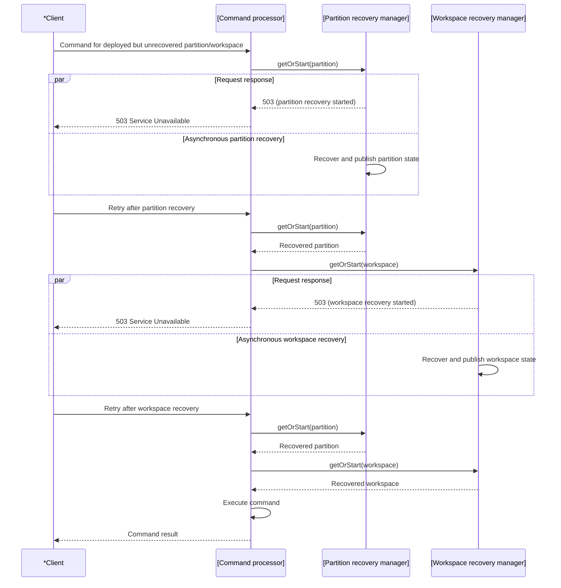

# Feature technical design: Partition and workspace recovery

Technical design for [Partition and workspace recovery](./recovery.feature).
Normal offset and identifier issuance is specified separately in
[Sequence allocation](./sequences--td.md).

## Key concepts

- **Recovery checkpoint**: a persisted log offset used as an inclusive recovery
  scan start. It accelerates recovery but is not authoritative sequence state.
- **Partition checkpoint**: `lastPLogOffset`, the latest handled PLog offset
  selected by initial recovery or the asynchronous checkpoint projector.
- **Workspace checkpoint**: `wlogIDBearingOffset`, the last seen ID-bearing WLog offset.
  Such an event allocates beyond all earlier IDs, so scanning from it preserves
  coverage of the maximum allocated ID. The offset is never treated as the WLog end.
- **Zero-value initialization sentinel**: a present zero partition checkpoint
  marks an initialized empty PLog; a present zero workspace checkpoint marks an
  encountered workspace with no eligible ID-bearing event. Either zero selects
  one scan from `FirstOffset` without validation or invalid-checkpoint logging.
- **ID-bearing event**: an event that allocates at least one new non-singleton
  record ID at or above `FirstUserRecordID`, including logged argument roots
  and descendants as well as newly created CUD rows.
- **Initial recovery**: bootstrap-time computation and persistence of missing
  checkpoints for every declared application partition, including Workspace
  checkpoints pointing to the latest ID-bearing WLog events,
  or zero when none exist. It does not publish runtime partition or workspace state.
- **Initial-recovery completion marker**: presence of a partition checkpoint,
  including a zero-valued one. Workspace checkpoints derived from a partition
  are stored before this marker.
- **Deployable partition**: a declared partition whose existing completion marker was
  read successfully or whose missing checkpoints were reconstructed and
  persisted successfully by the current initial-recovery invocation.
- **Undeployed partition**: a declared partition for which no runtime partition
  has been created. An initial-recovery failure excludes that ID from deployment
  for the current server run. The application remains registered for routing,
  but no asynchronous actualizers or schedulers exist for the excluded ID.
- **Inclusive log tail scan**: `ReadPLog` or `ReadWLog` begins at the checkpointed
  event and continues through the actual log end.
- **Checkpoint fallback**: one scan from `FirstOffset` after a nonzero checkpoint
  fails validation. Recovery does not repair the stored checkpoint.
- **Partition recovery**: service-scoped, request-triggered restoration of the
  next PLog offset followed by reapplication of the final event.
- **Workspace recovery**: lazy, request-triggered restoration of one workspace's
  next WLog offset and ordinary record-ID generator.

Every WLog event originates in its partition's PLog. An empty PLog therefore
implies empty WLogs for all workspaces in that partition. Empty-partition
fixtures must preserve both logs; clearing only a provisioned PLog produces an
impossible history and is not a recovery scenario.

## External actors

Systems:

- `*Client`
  - Submits commands whose partition and workspace state may require recovery.

## Components

### Layers

```text
Bootstrap
    |
    +-- [Bootstrap operator]
    +-- [Checkpoint initial recovery]
    |
    v
Request recovery
    |
    +-- [Command processor]
    +-- [Partition recovery manager]
    +-- [Workspace recovery manager]
    +-- [Offsets bookkeeping]
    +-- [Record ID generator]
    |
    v
Checkpointing
    |
    +-- [Recovery checkpoint projector]
    +-- [(Recovery checkpoint storage)]
    |
    v
Application operations
    |
    +-- [Application events]
    +-- [Application records]
    +-- [App partitions engine]
```

### Bootstrap

- `[Bootstrap operator]`
  - Registers each application with `[App partitions engine]`, invokes
    `[Checkpoint initial recovery]`, logs each returned partition-error map
    entry once with app QName and partition ID, and passes only the returned
    deployable IDs to `DeployAppPartitions`. An empty ID slice skips that call.
    The descriptor's full `NumParts` remains available for routing and is supplied
    unchanged as `NumPartitions` to `c.cluster.DeployApp`. Checkpoint outcomes
    affect only the IDs passed to partition deployment.
  - A returned setup or cancellation error stops bootstrap without deploying
    partitions from that invocation. Partition-scoped failures exclude only
    the affected IDs; for non-cluster applications readiness remains successful
    even when no IDs are returned.
  - Applies the same gate to cluster, built-in, and sidecar applications. The
    bootstrap dependency path when the cluster partition is unavailable belongs
    to [Apps deployment](./arch-deployment.md#bootstrap-failure-and-readiness);
    bootstrap returns an error if that sole partition cannot initialize or deploy,
    before processing other applications.
  - impl: [pkg/btstrp/impl.go](../../../../pkg/btstrp/impl.go)

- `[Checkpoint initial recovery]`
  - `checkpoints.IInitialRecovery.InitializeCheckpoints(ctx, appQName, numPartitions)` returns
    `([]istructs.PartitionID, map[istructs.PartitionID]error, error)`: deployable
    IDs, operation-specific errors keyed by failed partition ID, and an optional
    fatal app-structures setup or context error. IDs belong to `0..numPartitions-1`.
    When the fatal error is nil, the slice and map are disjoint and cover every
    declared partition exactly once. An empty slice and a complete error map
    with a nil fatal error are valid. A non-nil fatal error prevents deployment
    from the returned IDs; collected partition errors can still be logged.
  - Obtains the application's event storage and uses `checkpoints.workerLimit`,
    sampled from `runtime.GOMAXPROCS(0)` at package initialization. A present
    partition checkpoint, including zero, makes that
    partition deployable without scanning or rewriting it. Each missing partition
    is scheduled concurrently under this shared CPU bound and reads its PLog
    sequentially from `FirstOffset` through the actual log end. The attempt
    retains the final PLog offset and latest ID-bearing WLog offset for every
    WSID encountered.
  - It stores a workspace checkpoint for every encountered WSID, using zero when
    no eligible ID-bearing event was found, and stores the partition checkpoint last,
    using zero for an empty PLog. The partition is added to the deployable IDs
    only after all these writes succeed. A failed reconstruction writes no
    completion marker and is repeated on a later bootstrap.
  - Every partition checkpoint-read, PLog-read, or checkpoint-write error omits
    that ID from the deployable slice and adds it to the error map, retaining
    the failed operation and wrapping the underlying cause. Concurrent attempts
    collect their outcomes safely; the returned map is complete once all
    scheduled attempts finish. A checkpoint-read failure never authorizes
    deployment, even if a stored marker might exist. Partition-failure logging
    belongs to `[Bootstrap operator]`;
    the initializer does not duplicate those logs. No retained cause or
    error-registration method is added to `[App partitions engine]` or
    `[Command processor]`.
  - Waits for all scheduled attempts without canceling siblings after a
    partition-scoped failure. Only app-structures setup failure before scheduling
    or bootstrap-context cancellation is returned as the fatal error.
  - decl: [pkg/checkpoints/types.go#IInitialRecovery](../../../../pkg/checkpoints/types.go)
  - impl: [pkg/checkpoints/initial_recovery.go](../../../../pkg/checkpoints/initial_recovery.go)

### Recovery on command request

- `[Command processor]`
  - Borrows the runtime partition before authentication and workspace checks.
    When `Borrow` returns `appparts.ErrNotFound`, uses the existing
    `IAppPartitions.AppPartsCount` registration lookup to distinguish a missing
    application from a missing partition, without parsing error text or adding
    a new app-partitions error contract. A missing application returns
    `400 Bad Request` with `application not found`; a missing partition of a
    registered application returns `500 Internal Server Error` with
    `partition not found`. Neither message repeats application or partition
    identifiers: command error logs carry `vapp=<appQName>` and
    `partid=<partitionID>`, including when borrowing fails. Engine exhaustion
    (`ErrNotAvailableEngines`) remains `503`.
  - Repeated commands to an undeployed partition return the same not-found
    error, even after its storage becomes healthy, and never reach runtime
    recovery, command execution, offset allocation, or event writes. A later
    bootstrap must successfully initialize the partition before it can deploy.
  - For a deployed partition, runs partition recovery orchestration after
    authentication/workspace checks and workspace recovery orchestration after a
    recovered partition is available. A command does not execute on the request
    that starts either recovery.
  - impl: [pkg/processors/command/provide.go](../../../../pkg/processors/command/provide.go)
  - impl: [pkg/processors/command/impl.go](../../../../pkg/processors/command/impl.go)

- `[Partition recovery manager]`
  - Owns states keyed by application and partition. Concurrent requests share
    one attempt; a failure is retained for the next request, which receives the
    failure while starting exactly one retry when capacity is available. A full
    manager returns the concurrency-limit error without consuming the retained
    failure. Production partition recovery has no concurrency bound.
  - Uses the service context. Reset detaches old state so stale completion cannot
    publish into a replacement. The caller cancels the context; the generic
    manager's shutdown waits for its registered workers and then clears its state.
    New attempts and retries share one capacity check and startup path.
    On reset, atomically remove the partition entry and return its recovered
    value, if any. Outside the manager mutex, cancel that value's workspace
    recovery context with cause `errPartitionReset`. Reset performs no join.
  - Constructs an attempt only after admission reserves a slot. For partition
    recovery this is when the request's borrowed partition is transferred to
    the recovery workpiece, which releases it when the attempt finishes. The
    release is deferred before invoking the attempt hook, including when an
    injected error or cancellation causes the hook to skip actual recovery
  - impl: [pkg/processors/command/recovery_manager.go](../../../../pkg/processors/command/recovery_manager.go)
  - impl: [pkg/processors/command/impl.go](../../../../pkg/processors/command/impl.go)

- `[Workspace recovery manager]`
  - Lives within a recovered partition, owns states keyed by application,
    partition, and WSID. It uses a four-slot pool owned by the partition manager,
    keyed by application and partition, and set by the command processor's
    `numWSRecoverers` constant. Replacement partition state reuses the same pool,
    so workers detached by reset continue to consume capacity until they finish.
    No VVM configuration field changes this limit.
    Saturation returns `503` without creating state or queueing work.
  - Reuses the generic manager's retained-failure, retry, and stale-completion
    behavior. Each recovered partition owns a workspace-recovery context derived
    from the service context with `context.WithCancelCause`; reset cancels only
    that partition instance. Request cancellation does not cancel this context.
    A replacement partition receives a fresh child of the service context.
    The generic constructor also supports zero
    capacity for technical tests, where no attempt is admitted.
  - Before a recovered partition is published, its workspace manager shares the
    partition manager's worker wait group. The existing shutdown call therefore
    joins workspace workers even when reset has detached their partition.
  - impl: [pkg/processors/command/recovery_manager.go](../../../../pkg/processors/command/recovery_manager.go)
  - impl: [pkg/processors/command/impl.go](../../../../pkg/processors/command/impl.go)

- `[Offsets bookkeeping]`
  - Holds `appPartition.nextPLogOffset` and `workspace.NextWLogOffset`. Recovery
    sets each value from the actual last callback plus one, or `FirstOffset` for
    an empty complete scan.
  - impl: [pkg/processors/command/types.go](../../../../pkg/processors/command/types.go)

- `[Record ID generator]`
  - Starts at `FirstUserRecordID`; workspace recovery advances it from the maximum
    newly allocated non-singleton ID encountered in the complete WLog tail scan.
    A legacy `c.sys.Init` insert with a lower caller-supplied ID must not lower
    this maximum. A stored checkpoint pointing at a `c.sys.Init` event triggers
    the full-scan fallback.
  - impl: [pkg/istructsmem/idgenerator.go](../../../../pkg/istructsmem/idgenerator.go)

### Checkpointing

- `[Recovery checkpoint projector]`
  - The single built-in asynchronous `sys.ApplyRecoveryCheckpoint` stores a
    partition checkpoint every 100 PLog events and replaces the workspace
    checkpoint whenever it sees an ID-bearing event. Both initial
    recovery and this projector use the same checkpoint eligibility predicate.
    Legacy `c.sys.Init` events carry caller-supplied record IDs and leave the
    earlier checkpoint in place. Initial recovery stores zero for a workspace
    with only these events, and Workspace recovery scans its full WLog. No
    allocated IDs or in-memory maximum-ID cache are added to checkpoint storage.
  - impl: [pkg/checkpoints/impl.go](../../../../pkg/checkpoints/impl.go)
  - impl: [pkg/checkpoints/provide.go](../../../../pkg/checkpoints/provide.go)

- `[(Recovery checkpoint storage)]`
  - Last-write-wins storage for independent partition and workspace JSON values.
    Partition keys include application and partition; workspace keys include
    application and WSID. Recovery reads but never rewrites checkpoints.
  - decl: [pkg/checkpoints/interface.go](../../../../pkg/checkpoints/interface.go)
  - impl: [pkg/vvm/storage/impl_recoverycheckpoint.go](../../../../pkg/vvm/storage/impl_recoverycheckpoint.go)

#### Recovery checkpoint storage format

Partition checkpoints and Workspace checkpoints are separate entries in the
`sys/vvm` application storage, accessed through `ISysVvmStorage`. Each entry
consists of a binary partition key (`pKey`), clustering columns (`cCols`), and
a UTF-8 JSON value.

Key fields are concatenated in the order shown below. All integers in the key
are unsigned and encoded in big-endian byte order. Both checkpoint types use
the single byte `0x01` as `cCols`.

Partition checkpoint `pKey` (10 bytes, prefix `pKeyPrefix_SeqStorage_Part`):

```text
[ pKeyPrefix_SeqStorage_Part(uint32(2)) | ClusterAppID (uint32) | PartitionID (uint16) ]
          bytes 0..3                          bytes 4..7             bytes 8..9
```

Workspace checkpoint `pKey` (16 bytes, prefix `pKeyPrefix_SeqStorage_WS`):

```text
[ pKeyPrefix_SeqStorage_WS(uint32(3)) | ClusterAppID (uint32) | WSID (uint64) ]
          bytes 0..3                         bytes 4..7          bytes 8..15
```

The numeric prefixes retain the existing sequence-storage namespaces. Workspace
keys identify the application and WSID; the containing PartitionID is not part
of the Workspace checkpoint key.

| Checkpoint | JSON value example           | Offset meaning                                                    |
|------------|------------------------------|-------------------------------------------------------------------|
| Partition  | `{"lastPLogOffset":42}`      | Inclusive PLog scan start                                         |
| Workspace  | `{"wlogIDBearingOffset":43}` | Inclusive WLog scan start at an ID-bearing event |

Writers store exactly the indicated field as an unsigned 64-bit decimal JSON
number. Readers require that field and ignore additional fields. Malformed
JSON, a missing required field, or a value that cannot be decoded as an
`istructs.Offset` returns a checkpoint-storage read error.

A missing entry returns `exists=false`. A stored offset of zero returns
`exists=true` and selects a full scan from `FirstOffset` without checkpoint
validation. Partition checkpoint presence, including zero, also marks Initial
recovery complete. Writes use unconditional `Put`, so the last write replaces
the previous value even when its offset is lower.

The layout is defined by
[storage constants](../../../../pkg/vvm/storage/consts.go) and
[checkpoint encoding](../../../../pkg/vvm/storage/impl_recoverycheckpoint.go).
[Storage tests](../../../../pkg/vvm/storage/impl_recoverycheckpoint_test.go)
verify key isolation, JSON values, read errors, and replacement behavior.

### Application operations

- `[Application events]`
  - Supplies complete PLog/WLog reads or inclusive log tail scans. Initial
    recovery reads PLogs only; partition recovery reads a PLog; workspace
    recovery reads a WLog.
  - decl: [pkg/istructs/interface.go](../../../../pkg/istructs/interface.go)
  - impl: [pkg/istructsmem/impl.go](../../../../pkg/istructsmem/impl.go)

- `[Application records]`
  - Reapplies the final recovered partition event through the event-reapply path;
    record and WLog writes are unconditional and consume no new PLog offset.
  - impl: [pkg/istructsmem/impl.go](../../../../pkg/istructsmem/impl.go)

- `[App partitions engine]`
  - Registers application structures and the full declared partition count
    before initial recovery. `DeployAppPartitions` creates runtime partitions
    and starts actualizers and schedulers only for the supplied deployable IDs.
    Excluded IDs therefore start no asynchronous projectors, checkpoint
    projectors, or scheduled jobs, including after healthy partitions begin work.
  - `Borrow` for an absent runtime partition keeps returning the existing
    `ErrNotFound` error. The contract and errors are unchanged; no initial-recovery
    failure state is stored here. Query response policy is unchanged.
  - Invokes synchronous projectors when runtime partition recovery reapplies
    the final event for a deployed partition.
  - decl: [pkg/appparts/interface.go](../../../../pkg/appparts/interface.go)
  - impl: [pkg/appparts/impl.go](../../../../pkg/appparts/impl.go)

## Scenarios

### Initial recovery

#### Normal initial partition recovery

Initial recovery does not fail in this scenario.

```text
[Bootstrap operator]
  -> [App partitions engine]: register application with partitions 0..2
  -> [Checkpoint initial recovery]: InitializeCheckpoints(application, 3)
      -> [(Recovery checkpoint storage)]: partition 0 present -> skip
      -> [Application events]: scan complete PLogs for missing partitions 1 and 2
      -> [(Recovery checkpoint storage)]: partition 1 workspace checkpoints 10=6, 11=0
      -> [(Recovery checkpoint storage)]: partition 1 checkpoint=50 (completion marker)
      -> [(Recovery checkpoint storage)]: partition 2 checkpoint=0 (empty completion marker)
      - return deployable IDs [0, 1, 2], empty error map, nil
  -> [App partitions engine]: DeployAppPartitions(application, [0, 1, 2])
```

Workspace writes for one partition complete before its partition marker. The
relative ordering of different partition attempts is unconstrained.

#### Initial recovery failures are logged while the server becomes ready

```text
[Checkpoint initial recovery]
  -> scheduled missing partitions, bounded by package-initialized workerLimit
      -> [Application events]: one or every PLog scan fails
      - collect each partition-scoped failure in the error map; write no marker for it
      - let every sibling attempt finish; wait for all scheduled attempts
  -> [Bootstrap operator]: return deployable IDs, partition-error map, nil
      - log one bootstrap.initial_recovery.error per map entry with app QName and partition ID
      -> [App partitions engine]: deploy only returned IDs; skip call if empty
      - failed IDs have no runtime partitions, actualizers, or schedulers
      - server ready even if every partition was excluded
```

#### Commands return 500 on a partition whose initial recovery failed

```text
[Bootstrap operator]
  -> [Checkpoint initial recovery]: partition 1 PLog scan fails
  -> [App partitions engine]: exclude partition 1; server ready
*Client
  -> [Command processor]: insert into Billing (partition 1), without retries
      -> [App partitions engine]: Borrow -> ErrNotFound
      - return 500: partition not found
```

If setup fails before partition scheduling or the bootstrap context is canceled,
`InitializeCheckpoints` returns a fatal error and `[Bootstrap operator]` does not deploy that
application's partitions. Readiness is otherwise independent of how many
scheduled non-cluster application partition attempts failed, including all of
them. Failure of the cluster application's sole partition stops bootstrap.

#### The router receives the full partition count from the application descriptor despite initial recovery failures

```text
[Bootstrap operator]
  - application descriptor NumParts=3; workspace 10 belongs to partition 1
  -> [App partitions engine]: register full declared count 3
  -> [Checkpoint initial recovery]: partition 1, or every partition, fails
  -> [App partitions engine]: deploy eligible IDs [0, 2], or skip deployment
  - preserve descriptor and advertised partition count 3
*Client
  -> [Router]: compute the request partition using the application descriptor's NumPartitions=3
      - workspace 10 maps to partition 10 % 3 = 1 regardless of checkpoint failures
      -> [Command processor]: command for workspace 10 in partition 1
      -> [App partitions engine]: Borrow(partition 1) -> ErrNotFound
      - return 500: partition not found
      - do not reroute using the successful count or append events in any partition
```

Bootstrap's `c.cluster.DeployApp` request supplies the descriptor's full count
before initial recovery; the command has no checkpoint-outcome input. Its
compatibility check remains independent of the runtime deployment set. The
source-of-count contract and overwrite risk are specified in
[Preserve declared partition count after partial initialization](./arch-deployment.md#preserve-declared-partition-count-after-partial-initialization).

#### A changed app descriptor partition count causes panic

```text
[VIT.RestartVVM]: WithNewConfig declares NumPartitions=2; retain existing storage
  -> [Bootstrap operator]: c.cluster.DeployApp validates the configured descriptor
      - persisted count 3 differs -> existing 409 Conflict; VVM launch panics
  - preserve the complete persisted descriptor; do not start the application
```

The VIT test restarts a fully deployed application using a replacement configuration.

The descriptor-validation implementation and components belong to
[Reject incompatible redeployment](./arch-deployment.md#reject-incompatible-redeployment).

#### VVM launch fails with an error on failure of the initial recovery of a partition of the Cluster app

```text
[Bootstrap operator]
  -> [Checkpoint initial recovery]: cluster partition fails; no eligible ID
  - log the partition error and return a cluster partition error
  - stop before other application registration, provisioning, or partition deployment
  - server does not become ready
```

The test provides a fresh VVM with a PLog read failure enabled for `sys/cluster`
partition 0. Its first `VoedgerVM.Launch` returns a closed problem context.
`Shutdown` exposes the cluster partition error and `ErrVVMServicesLaunch`.

#### A later bootstrap deploys a previously failed partition after successful initial recovery

```text
[Previous VVM start]
  - partition 1 initial recovery failed; partition 1 was not deployed
[Next VVM start]: partition 1 storage is healthy
  -> [Checkpoint initial recovery]: retry partition 1 without a completion marker
      - initial recovery succeeds; include partition 1 in deployable IDs
  -> [App partitions engine]: deploy partition 1
*Client
  -> [Command processor]: insert an ordinary record into Billing; retry 503 during runtime recovery
      - recover Billing's WLog offset 14 and last ordinary record ID 200005
      - return 200 with CurrentWLogOffset=15 and new ordinary record ID=200006
```

### Partition recovery orchestration

#### At least the first two command requests to a partition and workspace return 503 after initial recovery

```text
[Bootstrap operator]
  -> [Checkpoint initial recovery]: persist missing checkpoints only
  -> [App partitions engine]: deploy partition workers; server ready
*Client
  -> [Command processor]: first command, without retries -> 503
      -> [Partition recovery manager]: start recovery
  -> [Command processor]: second command, without retries -> 503
      - partition still recovering, or start lazy workspace recovery
  -> [Command processor]: third command, retry 503 -> 200 after both recoveries complete
```

Initial recovery creates checkpoints without publishing runtime recovery state.
The second request receives 503 whether partition recovery is still running or
has completed and workspace recovery starts. VIT verifies the HTTP responses;
the internal command-processor test also verifies the partition and workspace
lifecycle logs and their order.

#### A query does not trigger partition recovery

```text
*Client
  -> [Query processor]: first query to an existing workspace, without retries
      -> [Application records]: read persisted query data -> 200
      - start no partition or workspace recovery
```

#### Concurrent requests to the same partition start only one recovery

```text
*Client
  -> [Command processor]: request 1 -> start partition recovery -> 503
  -> [Command processor]: concurrent requests 2..6 while recovery is blocked -> 503
      - retain one attempt; log cp.error with partition 1: recovery is in progress
  -> [Command processor]: request 7 after partition recovery; retry 503 for workspace recovery -> 200
      - CurrentWLogOffset=2; new record IDs=200001..200003
      - exactly one cp.partition_recovery.start for partition 1
```

#### A command succeeds in another partition while partition recovery is running

```text
[Partition recovery manager]: partition 1 recovery is blocked
*Client
  -> [Command processor]: insert into workspace 2 in partition 0; retry 503
      -> [Partition recovery manager]: recover partition 0 independently
      -> [Workspace recovery manager]: recover workspace 2
      - return 200 with CurrentWLogOffset=2 and new ordinary record ID=FirstUserRecordID
      - partition 1 recovery has not completed
```

#### Canceling the initiating request does not stop partition recovery

```text
*Client
  -> [Command processor]: command starts partition 1 recovery -> 503
  - cancel the initiating request
[Partition recovery manager]: continue with the command service's context
  - complete the original attempt
*Client
  -> [Command processor]: insert three ordinary records; retry 503 for workspace recovery -> 200
      - CurrentWLogOffset=2; new record IDs=200001..200003
      - exactly one cp.partition_recovery.start for partition 1
```

#### An unauthenticated command does not trigger partition recovery

```text
*Client
  -> [Command processor]: command with invalid token, without retries
      -> [Authenticator]: reject -> 401
      - start no partition or workspace recovery
```

#### The next request restarts recovery of the failed partition and report the error

```text
*Client
  -> [Command processor]: request 1 -> start partition recovery -> 503
[Partition recovery manager]: retain PLog read failed
*Client
  -> [Command processor]: request 2 -> report retained failure and start one new attempt -> 500
  -> [Command processor]: request 3 while the new attempt is blocked -> 503
      - start no additional attempt
  -> [Command processor]: request 4 after the new attempt completes; retry 503 for workspace recovery -> 200
      - CurrentWLogOffset=2; new record IDs=200001..200003
```

The existing `TestPartitionRecovery` tests cover these command scenarios with
deterministic recovery gates and injected failures. They retain the concurrent
requests, lifecycle logs, cancellation, and successful command checks. Production
partition recovery has no concurrency limit; the synthetic zero-capacity and
service-shutdown tests remain internal checks. Workspace recovery continuing
across a partition reset remains under Workspace recovery orchestration.

### Partition recovery

#### Normal partion recovery from checkpoint

```text
*Client
  -> [Command processor]: insert an ordinary record into workspace 1; retry 503 during runtime recovery
      -> [Partition recovery manager]: start -> 503
          -> [(Recovery checkpoint storage)]: absent, zero, or valid lastPLogOffset
          -> [Application events]: ReadPLog(checkpoint or FirstOffset, through log end)
          -> [Offsets bookkeeping]: nextPLogOffset = 51 after PLog end 50
          -> [Application records]: reapply final event when present
  -> [Command processor]: retry enters workspace recovery -> 503
      -> [Workspace recovery manager]: recover workspace 1
          -> [Offsets bookkeeping]: next WLog offset = 15 after WLog end 14
          -> [Record ID generator]: next ordinary record ID = 200006 after 200005
  -> [Command processor]: retry inserts the record
      - return 200 OK with CurrentWLogOffset=15 and new ordinary record ID=200006
```

Local Command processor tests restart only the processor, preserving the stored
checkpoints. They record the offset and count passed to `ReadPLog` and require
exactly one read from the checkpoint, or `FirstOffset` for an absent or zero
checkpoint, with `ReadToTheEnd`. The successful insert verifies recovered
sequence numbers. Initial recovery is outside these tests.

#### Invalid partition checkpoint causes PLog read out from beginning

```text
[Partition recovery manager]
  -> [(Recovery checkpoint storage)]: nonzero lastPLogOffset
  -> [Application events]: inclusive log tail scan returns no callback or a different first offset
      - checkpoint is beyond the PLog end, before its first available event,
        or points to a missing event between available events
  - log cp.partition_recovery.checkpoint.invalid
  -> [Application events]: one fallback ReadPLog(FirstOffset, through log end)
  -> [Offsets bookkeeping]: nextPLogOffset = actual log end + 1
*Client
  -> [Command processor]: insert into recovery-test-workspace; retry 503 during runtime recovery
      -> [Workspace recovery manager]: recover workspace offsets and ordinary record IDs
      - return 200 OK with CurrentWLogOffset=15 and new ordinary record ID=200006
```

These cases are tested through commands after a VVM restart.

#### Empty PLog recovery preserves initial sequence numbers

```text
[Partition recovery manager]
  -> [(Recovery checkpoint storage)]: absent, zero, or nonzero checkpoint
      - absent or zero: read directly from FirstOffset
      - nonzero: read checkpoint -> empty; log cp.partition_recovery.checkpoint.invalid
        and retry from FirstOffset
  -> [Application events]: ReadPLog(FirstOffset, through log end) -> empty
  -> [Offsets bookkeeping]: nextPLogOffset = FirstOffset
  - publish partition without reapplication
*Client
  -> [Command processor]: insert an ordinary record; retry 503 during runtime recovery
      -> [Workspace recovery manager]: recover the empty WLog
          -> [Offsets bookkeeping]: next WLog offset = 1
          -> [Record ID generator]: next ordinary record ID = 200001
      - return 200 OK with CurrentWLogOffset=1 and new ordinary record ID=200001
```

Tests send insert commands through the internal command processor and verify
the returned status, offset, and record ID. The fixture seeds only the system
workspace descriptor directly into records, keeping both logs empty; VIT
workspace provisioning would write log events.

An empty WLog has no corresponding workspace events in the PLog, so Initial
recovery does not encounter that workspace and does not create its checkpoint.
The absent-checkpoint test also verifies that no workspace checkpoint is stored
and no invalid workspace-checkpoint error is logged after recovery. Initial
allocation values are specified in [Sequence allocation](./sequences.feature).

### Workspace recovery

#### Normal workspace recovery from checkpoint

```text
*Client
  -> [Command processor]: insert after partition recovery; retry 503 during workspace recovery
      -> [Workspace recovery manager]: reserve slot; start -> 503
          -> [(Recovery checkpoint storage)]: absent, zero, or valid wlogIDBearingOffset
          -> [Application events]: ReadWLog(checkpoint or FirstOffset, through log end)
              - when the ID-bearing checkpoint is at the WLog end, read only that event
          -> [Offsets bookkeeping]: NextWLogOffset = actual log end + 1
          -> [Record ID generator]: advance from maximum allocated ID found by the log tail scan
  -> [Command processor]: retry returns 200 OK with CurrentWLogOffset=lastWLogOffset+1
      - WLog end 14 -> CurrentWLogOffset=15; WLog end 10 -> CurrentWLogOffset=11
      - new ordinary record ID=200006 in every case
```

Local Command processor tests complete Partition recovery before submitting the
insert. They record the offset and count passed to `ReadWLog` and require exactly
one read from the checkpoint, or `FirstOffset` for an absent or zero checkpoint,
with `ReadToTheEnd`. The successful insert verifies recovered sequence numbers.

#### Workspace recovery preserves sequence numbers after a mixed non-ID-bearing WLog tail

```text
[Workspace recovery manager]
  -> [Application events]: ReadWLog(10, through log end)
      - offset 10: ID-bearing event; greatest allocated record ID is 200005
      - offsets 11 and 12: non-CUD events
      - offset 13: singleton insert; no ordinary ID allocated
      - offset 14: update of record 200002; no new ID allocated
  -> [Offsets bookkeeping]: next WLog offset = 15
  -> [Record ID generator]: next ordinary record ID = 200006
*Client
  -> [Command processor]: insert one ordinary record; retry 503 during workspace recovery
      - return 200 OK with CurrentWLogOffset=15 and NewIDs={"1":200006}
```

#### Workspace without user record IDs starts allocation at FirstUserRecordID

```text
[Workspace recovery manager]
  -> [(Recovery checkpoint storage)]: wlogIDBearingOffset = FirstOffset (1)
  -> [Application events]: checkpoint event is non-ID-bearing
  - log cp.workspace_recovery.checkpoint.invalid
  -> [Application events]: rescan from FirstOffset; offsets 1 through 3 have no ID-bearing event
  -> [Offsets bookkeeping]: NextWLogOffset = 4
  -> [Record ID generator]: retain FirstUserRecordID
*Client
  -> [Command processor]: insert one ordinary record; retry 503 during workspace recovery
      - return 200 OK with CurrentWLogOffset=4 and new ordinary record ID=FirstUserRecordID (200001)
```

#### Invalid workspace checkpoint falls back to the WLog beginning

```text
[Workspace recovery manager]
  -> [Application events]: inclusive log tail scan from nonzero checkpoint
      - no callback, different first offset, or first event is not ID-bearing
  - log cp.workspace_recovery.checkpoint.invalid
  -> [Application events]: one fallback ReadWLog(FirstOffset, through log end)
  -> [Offsets bookkeeping] + [Record ID generator]: restore from complete fallback
*Client
  -> [Command processor]: insert one ordinary record; retry 503 during workspace recovery
      - return 200 OK with CurrentWLogOffset=15 and new ordinary record ID=200006
```

### Empty WLog

#### Invalid workspace checkpoint over an empty WLog

```text
[Workspace recovery manager]
  -> [Application events]: read nonzero checkpoint -> no callback
  - log invalid checkpoint
  -> [Application events]: fallback from FirstOffset -> empty
  -> [Offsets bookkeeping]: NextWLogOffset = FirstOffset
  -> [Record ID generator]: next ID = FirstUserRecordID
*Client
  -> [Command processor]: insert one ordinary record; retry 503 during workspace recovery
      - return 200 OK with CurrentWLogOffset=FirstOffset and new ordinary record ID=FirstUserRecordID
```

### Workspace recovery orchestration

#### Concurrent requests to the same workspace start only one recovery

```text
*Client
  -> [Command processor]: first ordinary record insert, without retries -> 503
      -> [Workspace recovery manager]: reserve slot and start recovery
  -> [Command processor]: second insert while recovery is blocked, without retries -> 503
      -> [Workspace recovery manager]: share the running attempt
  - exactly one workspace-recovery start is logged
  -> [Command processor]: third insert after recovery completes, without retries -> 200 OK
      - CurrentWLogOffset=15 and new ordinary record ID=200006
```

The test uses internal command-processor recovery gates to hold the first
recovery open through the second request. VIT has no direct recovery gate;
testing this through VIT would require a custom storage wrapper to delay reads.

#### Num of workspaces recovering at the same time is limited per partition

The glossary defines a limit of four simultaneous workspace recoveries per
partition. Workspaces 42 through 46 in this scenario belong to the same partition.

```text
*Client
  -> [Workspace recovery manager]: workspaces 44..46 occupy three of four slots
  -> [Workspace recovery manager]: workspace 42; reserve final slot -> 503
  -> [Workspace recovery manager]: workspace 43; no slot -> 503
      - create no state and queue no worker for workspace 43
  -> [Workspace recovery manager]: after workspace 42 releases slot,
                                   a new request starts workspace 43 -> 503
  -> [Command processor]: insert after workspace 43 recovery completes -> 200 OK
      - CurrentWLogOffset=15 and new ordinary record ID=200006
```

#### A partition reset cancels current workspace recoveries without waiting for them to finish

```text
*Client
  -> [Workspace recovery manager]: workspaces 3 and 5 are reading WLogs
  -> [Command processor]: request 1 fails in a synchronous projector -> 500
      -> [Partition recovery manager]: detach old partition state under its mutex
      -> [Workspace recovery manager]: cancel old partition context with errPartitionReset
          - signal cancellation outside the mutex; do not wait for storage or workers
  -> [Command processor]: request 2 while old reads have not returned
      -> [Partition recovery manager]: start replacement partition recovery -> 503
          - recover using service context; create a fresh workspace-recovery context
          - retain the same partition-key slot pool and service worker wait group
      - replacement partition recovery completes before old reads return
  -> [Workspace recovery manager]: old reads return; observe cancellation and discard results
      - emit INFO cp.workspace_recovery.canceled, message "partition reset"
      - release each slot through normal worker completion; join only during shutdown
```

**Cancellation ownership and cooperative exit**

Each `appPartition` owns `workspaceRecoveryCtx` and `cancelWorkspaceRecovery`,
created from the service context before publication. Cancel on construction
failure; replacements get fresh contexts.

`recoveryManager.reset(key)` atomically detaches and returns the recovered value.
`partitionManager.scheduleRecovery` cancels it with `errPartitionReset` outside
the mutex, without canceling the service or waiting. Missing entries are no-ops;
unrecovered entries have no workspace workers.

Use the partition context for WLog scans and let `ReadWLog` handle cancellation
during reads. Check before the context-free checkpoint read, before fallback,
and when finalizing the result and its log. Always release events.
The generic worker discards data returned after cancellation and treats recovery
as canceled instead of marking it ready. Completion updates
only captured state, so late results cannot overwrite replacement state.

Storage calls may ignore cancellation and remain blocked. Workers retain slots
and shutdown registration until exit; admission returns concurrency-limit 503
while full. Reset and replacement partition recovery never join workers. Add no
helper goroutines or forced timeouts.

Observed `errPartitionReset` produces one INFO cancellation log instead of
completion or WLog-read ERROR logs. Earlier completions and genuine storage
errors keep normal handling. Service shutdown still cancels and joins workers;
it is not a partition reset.

#### The next request restarts recovery of the failed workspace and report the error

```text
*Client
  -> [Workspace recovery manager]: start attempt -> 503
      -> [Application events]: WLog read fails; retain failure
  -> [Workspace recovery manager]: next request gets retained failure;
                                   reserve slot and start one retry -> 500
  -> [Workspace recovery manager]: request while retry runs -> 503
  -> [Command processor]: insert after the new attempt completes -> 200 OK
      - CurrentWLogOffset=15 and new ordinary record ID=200006
```

## Sequence diagrams

### Request-driven partition then workspace recovery

Successful recovery for a deployed partition, with workspace recovery capacity
available. Each retry repeats authentication and workspace checks; workspace
recovery admission also follows rate limiting, command lookup, authorization,
and request-body validation.



## Cross-cutting concerns

### Failure isolation and shutdown

- Every scheduled `[Checkpoint initial recovery]` partition attempt owns its
  read and writes; its failure is returned in the partition-error map, excludes
  its ID from deployment, and does not cancel sibling attempts. Failures in
  non-cluster applications do not prevent readiness; an unavailable cluster
  partition stops bootstrap. A failed reconstruction writes no partition
  completion marker.
- Every `[Bootstrap operator]` invocation deploys only IDs returned without a
  fatal initial-recovery error. No excluded ID has runtime actualizers or
  schedulers; an empty ID slice starts no partition workers for that application.
- Every command to an excluded partition fails at `[App partitions engine]`
  borrowing with the existing not-found error, mapped to `500` before runtime
  recovery starts. Commands never retry initial recovery or deploy a partition.
- Every bootstrap-context cancellation stops scheduling, cancels in-flight
  initialization, waits for started work, and is returned to `[Bootstrap operator]`.
- Every partition-recovery attempt uses the VVM service context; workspace
  recovery uses a child context owned by its partition instance. Request
  cancellation does not cancel either recovery. Reset cancels the old partition's
  workspace context without joining its workers. Command-service shutdown joins the shared partition/workspace
  worker wait group before clearing partition state, including workers belonging
  to partitions detached by reset.
- Every recovery-manager key has at most one current attempt; reset may detach
  an attempt, whose later stale completion cannot overwrite replacement state.

### Observability

- Every request-driven partition log uses `vapp=sys/voedger`,
  `extension=sys._Recovery`, and `partid`; workspace logs add `wsid`.
- Every request admission or retained failure is emitted through `cp.error` with
  the affected partition or workspace in the message.
- Every malformed checkpoint is logged before its single `FirstOffset` fallback;
  read, reapply, start, and completion stages follow
  [Logging](./logging--td.md#command-processor).
- Every initial-recovery error map entry is logged once by `[Bootstrap operator]`
  through `bootstrap.initial_recovery.error`, identifying the application and
  partition. The initializer returns partition errors without logging them again.
  Each error identifies a partition-checkpoint-read, PLog-read,
  workspace-checkpoint-write, or partition-checkpoint-write failure.
  The application completion log is emitted only after every scheduled attempt
  has finished.
- Every undeployed-partition rejection uses the standard not-found message
  through `cp.error`; the initial-recovery cause remains only in the attempt log.
- Every workspace recovery that observes partition-reset cancellation emits one
  INFO `cp.workspace_recovery.canceled` record with message `partition reset` and
  attributes `app`, `partid`, and `wsid`; it emits no success or WLog-read-error
  record for that canceled attempt

### Performance and persistence

- Every application's initial recovery has at most `checkpoints.workerLimit`
  attempts in flight; the limit is sampled from `runtime.GOMAXPROCS(0)` at package
  initialization and applications are initialized in bootstrap order
- Every partition admits at most four concurrent workspace recovery attempts
  across both its current state and any state detached by reset, and never queues
  rejected work.
- Every nonzero recovery checkpoint is an inclusive scan start; correctness
  requires a log tail scan through the actual log end. Many non-ID-bearing WLog
  events after the checkpoint therefore increase workspace recovery time without
  changing record-ID state.
- Every checkpoint-storage write is last-write-wins. Initial recovery establishes
  missing completion markers; the asynchronous projector advances checkpoints;
  request-driven recovery never writes them.

### Testing

- Feature scenarios are traced to `recovery: scn:` tests in
  [VIT recovery tests](../../../../pkg/sys/it/impl_recovery_test.go) and
  [command-processor tests](../../../../pkg/processors/command/impl_test.go)
- VIT covers readiness responses and query behavior
- Internal command tests preserve partition and workspace orchestration
  coverage using deterministic recovery gates and injected failures
- Empty-log command fixtures seed only system workspace records
- The empty-partition case in "Normal initial partition recovery" is covered by
  [initial-recovery tests](../../../../pkg/checkpoints/initial_recovery_test.go).
  VIT provisioning creates both PLog and WLog events; those tests use an
  unprovisioned mock partition rather than deleting a provisioned partition's PLog.
- Initial-recovery deployable-ID/error-map outcomes, ordering, failure isolation,
  and cancellation are covered by
  [initial-recovery tests](../../../../pkg/checkpoints/initial_recovery_test.go). Bootstrap logs each returned
  error once and passes the deployable IDs directly to partition deployment;
  this is covered by [bootstrap tests](../../../../pkg/sys/it/impl_bootstrap_test.go).
- Selective deployment and the standard not-found error are covered by
  [app-partitions tests](../../../../pkg/appparts/impl_test.go) and
  [command tests](../../../../pkg/processors/command/impl_test.go). VIT scenarios
  cover ready servers with one or all user-app partitions excluded, configured
  projectors/jobs staying stopped, healthy commands, repeated `500` responses,
  and successful initialization on a later bootstrap.
- `TestBootstrapCheckpointFailuresPreserveDeclaredPartitionCount` verifies the
  deployment request, local registration, and persisted descriptor on first and
  repeated `Bootstrap` calls with one or all non-cluster partitions excluded.
  Repeated calls use fresh local partition managers against the running VIT;
  real VVM restarts and public routing are covered by the VIT recovery scenarios.
- Routing regression tests create a record before restart in a real WSID that
  maps to partition `1` with count `3` and partition `0` with count `2`. This
  represents logical workspace `10` without API v1's pseudo-workspace translation.
  After restart, the command fails for partition `1`, attempts no PLog/WLog
  writes in any partition, and leaves the record active. A separate descriptor
  mismatch test verifies `409 Conflict` and an unchanged persisted descriptor.
- Four-slot saturation and later retry are exercised through the command
  service. Zero-capacity behavior remains generic-manager technical coverage;
  it is not exposed as a production configuration. The admission test follows
  the four-slot feature's scenario identity and setup steps.
- Partition-reset coverage holds four old-generation workspace attempts open,
  recovers replacement partition state, verifies that a fifth attempt is still
  rejected, and then verifies that completion of a detached attempt returns one
  shared slot to the replacement generation.
- Generic deduplication, limits, retry, reset, stale completion, context, and
  own-worker shutdown behavior is exercised by
  [recovery-manager tests](../../../../pkg/processors/command/recovery_manager_test.go).
  `TestServiceShutdownWaitsForWorkspaceRecovery` holds a canceled worker before
  exit and verifies the service waits, both for a current partition and for one
  detached by reset.
